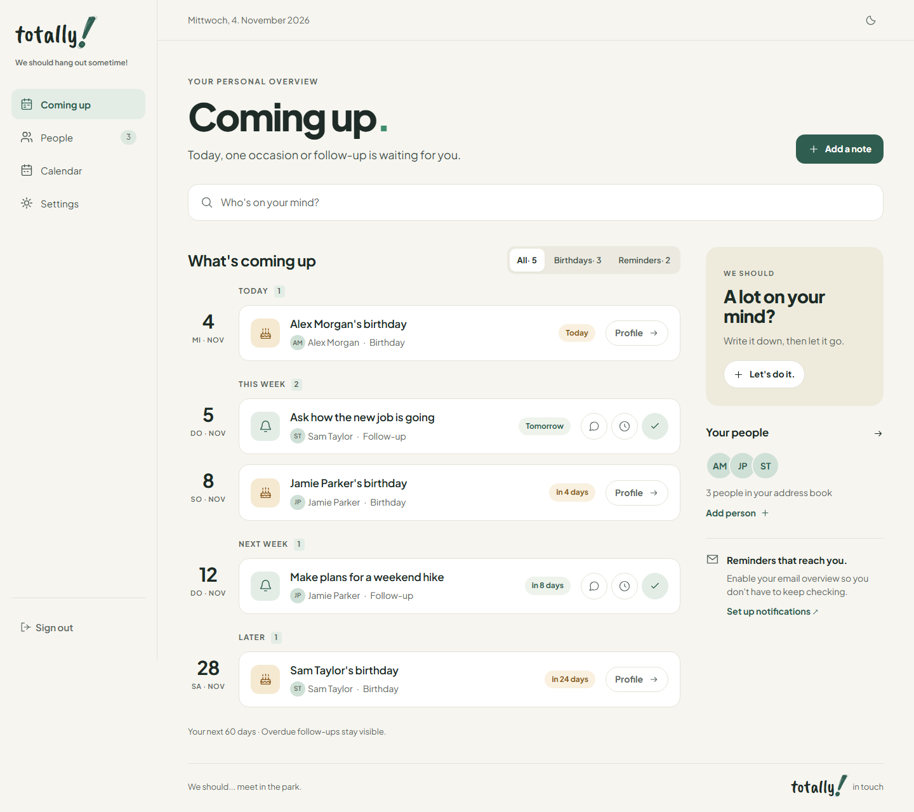

# totally!

**We should hang out sometime!**

[English](README.md) · [Deutsch](README.de.md)

Ein selbst gehostetes persönliches CRM für die Menschen in deinem Leben.
Gespräche festhalten, Geburtstage im Blick behalten und zur richtigen Zeit
nachfragen. Ein Container, ein Datenverzeichnis, keine separate Datenbank.
Für eine Person pro Installation.



## Funktionen

- **Deine Menschen:** Kontakte, Fotos, Adressen, Tags und Suche.
- **Eure Geschichte:** Notizen, Gespräche und laufende Themen mit einer oder mehreren Personen.
- **In Verbindung bleiben:** Geburtstage, Wiedervorlagen, persönliche Kontaktrhythmen und Kalender.
- **Ein kleiner Anstoß:** tägliche Erinnerungen per Web Push, optional per E-Mail über deinen SMTP-Dienst.
- **Überall zu Hause:** Desktop- und Mobilansicht, Hell-/Dunkelmodus und Installation auf dem Home-Bildschirm.
- **Deine Sprache, deine Daten:** englische und deutsche Oberfläche, ZIP-Sicherung und Kontakte mit Papierkorb.

## Schnellstart

Docker mit Compose vorausgesetzt. Als [compose.yaml](compose.yaml) speichern:

```yaml
services:
  app:
    image: ghcr.io/kingtiki/totally:latest
    restart: unless-stopped
    env_file: .env
    environment:
      HOST: 0.0.0.0
      PORT: 3000
      DATA_DIR: /app/data
      BODY_SIZE_LIMIT: '${BODY_SIZE_LIMIT:-110M}'
    ports:
      - '${BIND_ADDRESS:-127.0.0.1}:${APP_PORT:-3000}:3000'
    volumes:
      - totally-data:/app/data
    security_opt:
      - no-new-privileges:true
    cap_drop:
      - ALL
    stop_grace_period: 45s

volumes:
  totally-data:
```

Daneben eine private `.env` mit diesen drei Werten anlegen:

```dotenv
ORIGIN=http://localhost:3000
PASSWORD_HASH=scrypt:...
SESSION_SECRET=...
```

Login-Passwort, zugehörigen `PASSWORD_HASH` und zufälligen `SESSION_SECRET` erzeugen:

```sh
docker run --rm ghcr.io/kingtiki/totally:latest node scripts/setup.mjs --stdout
```

Den erzeugten Hash und das Secret in `.env` eintragen, das angezeigte Login-Passwort
speichern und starten:

```sh
docker compose up -d
```

**http://localhost:3000** öffnen. Für einen öffentlichen Server `ORIGIN` auf seine
tatsächliche HTTPS-Adresse setzen. Daten bleiben im benannten Volume `totally-data`
erhalten. Optionale Variablen, HTTPS, Updates und lokale Builds stehen in der
[Betriebsanleitung](docs/deployment.de.md).

## Mehr erfahren

[Nutzung](docs/usage.de.md) · [Betrieb](docs/deployment.de.md) · [Datensicherung](docs/backups.de.md) ·
[Mitmachen](CONTRIBUTING.de.md) · [Sicherheit](SECURITY.de.md)

Persistente Daten und private Konfiguration regelmäßig sichern. Die Anwendung
verschlüsselt Dateien auf dem Server nicht. Push und E-Mail nutzen die von dir
aktivierten Dienste.

## Lizenz

[MIT](LICENSE). Mitgelieferte Schriften stehen unter **SIL OFL 1.1**; siehe
[Hinweise zu Drittanbietern und Schriftlizenzen](THIRD_PARTY_NOTICES.de.md).
