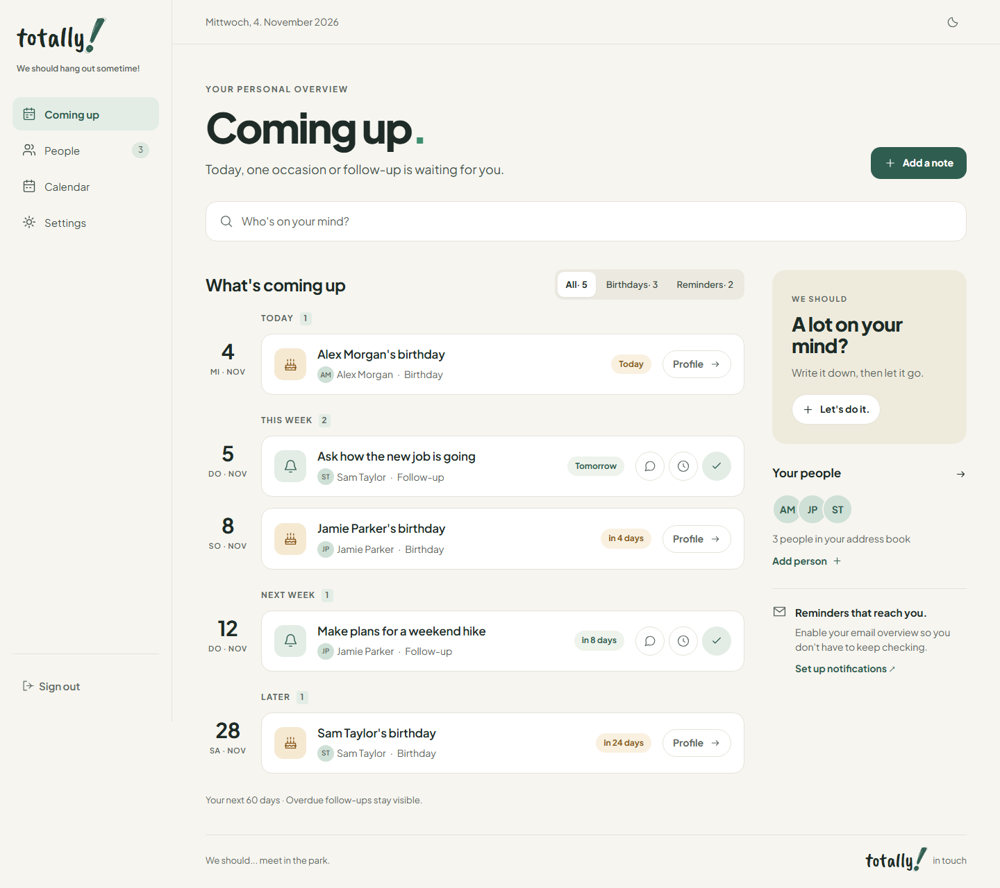

# totally!

**We should hang out sometime!**

[English](README.md) · [Deutsch](README.de.md)

A self-hosted personal CRM for the people in your life. Remember conversations,
keep track of birthdays and follow up when it matters. One container, one data
folder, no separate database. Made for one person per installation.



## Features

- **Your people:** contacts, photos, addresses, tags and search.
- **Your shared history:** notes, conversations and ongoing topics, linked to one or more people.
- **Keep in touch:** birthdays, follow-ups, personal contact schedules and a calendar.
- **A gentle nudge:** daily Web Push reminders, with optional email via your SMTP service.
- **At home anywhere:** desktop and mobile layouts, light/dark themes and home-screen installation.
- **Your language, your data:** English and German UI, ZIP backup/restore and recoverable contact trash.

## Quick start

Requires Docker with Compose. Save this as [compose.yaml](compose.yaml):

```yaml
services:
  app:
    image: ghcr.io/kingtiki/totally-test:latest
    restart: unless-stopped
    env_file: .env
    environment:
      HOST: 0.0.0.0
      PORT: 3000
      DATA_DIR: /app/data
      BODY_SIZE_LIMIT: '${BODY_SIZE_LIMIT:-110M}'
    ports:
      - '${BIND_ADDRESS:-127.0.0.1}:${APP_PORT:-3000}:3000'
    volumes:
      - totally-data:/app/data
    security_opt:
      - no-new-privileges:true
    cap_drop:
      - ALL
    stop_grace_period: 45s

volumes:
  totally-data:
```

Create a private `.env` next to it with these three values:

```dotenv
ORIGIN=http://localhost:3000
PASSWORD_HASH=scrypt:...
SESSION_SECRET=...
```

Generate a login password, its `PASSWORD_HASH` and a random `SESSION_SECRET`:

```sh
docker run --rm ghcr.io/kingtiki/totally-test:latest node scripts/setup.mjs --stdout
```

Copy the generated hash and secret into `.env`, save the displayed login password, then start:

```sh
docker compose up -d
```

Open **http://localhost:3000**. For a public server, set `ORIGIN` to its actual HTTPS
URL. Data persists in the named `totally-data` volume.
See [deployment](docs/deployment.md) for optional variables, HTTPS, updates and local builds.

## Learn more

[Usage](docs/usage.md) · [Deployment](docs/deployment.md) · [Backups](docs/backups.md) ·
[Contributing](CONTRIBUTING.md) · [Security](SECURITY.md)

Back up your persistent data and private configuration. Server-side files are not
encrypted by the app. Push and email use the services you enable.

## License

[MIT](LICENSE). Bundled fonts use **SIL OFL 1.1**; see
[third-party notices and font licenses](THIRD_PARTY_NOTICES.md).
